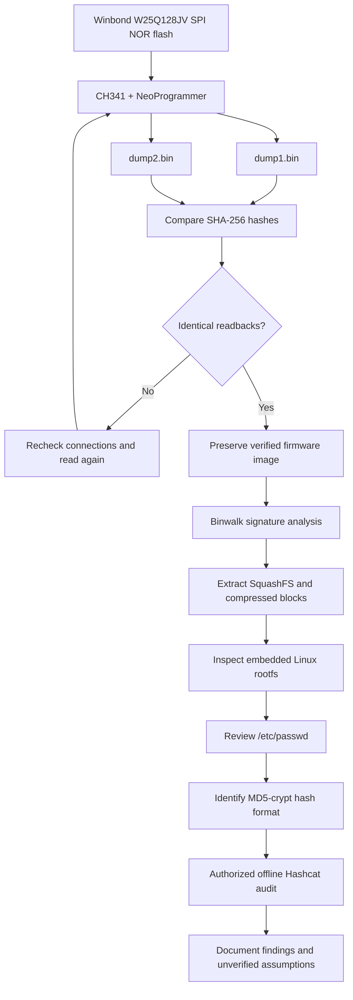

# SPI Flash Firmware Extraction and Credential Security Analysis

**Project:** Attackpath — SPI Chip Firmware Analysis  
**Focus:** SPI NOR flash acquisition, firmware integrity verification, embedded Linux filesystem extraction, and offline credential auditing  
**Source material:** `Attackpath_SPI_CHIP.pdf` (11 pages) and `Attackpath_SPI_CHIP.pptx` (11 slides)  
**Project status:** Static firmware analysis completed to the point of recovering a privileged account's password; on-device authentication and exploitability remain unverified.

> [!IMPORTANT]
> This README documents the observations shown in the supplied presentation. The original binary dump, target hardware, and extracted firmware were **not** supplied for independent validation. Commands are provided for reproducibility on a device you own or are explicitly authorized to assess. Do not publish the raw dump, extracted credential hash, or recovered password without authorization.

## Table of contents

1. [Project overview](#1-project-overview)
2. [Objectives and scope](#2-objectives-and-scope)
3. [Executive summary of findings](#3-executive-summary-of-findings)
4. [Hardware and software](#4-hardware-and-software)
5. [End-to-end analysis workflow](#5-end-to-end-analysis-workflow)
6. [Phase 1 — Acquire the SPI flash image](#6-phase-1--acquire-the-spi-flash-image)
7. [Phase 2 — Verify acquisition integrity](#7-phase-2--verify-acquisition-integrity)
8. [Phase 3 — Identify firmware components](#8-phase-3--identify-firmware-components)
9. [Phase 4 — Extract and inspect filesystems](#9-phase-4--extract-and-inspect-filesystems)
10. [Phase 5 — Examine account configuration](#10-phase-5--examine-account-configuration)
11. [Phase 6 — Identify and audit the password hash](#11-phase-6--identify-and-audit-the-password-hash)
12. [Findings and security impact](#12-findings-and-security-impact)
13. [Evidence and observation matrix](#13-evidence-and-observation-matrix)
14. [Reproduction checklist](#14-reproduction-checklist)
15. [Troubleshooting and pitfalls](#15-troubleshooting-and-pitfalls)
16. [Recommendations](#16-recommendations)
17. [Limitations and next steps](#17-limitations-and-next-steps)
18. [Repository structure and data handling](#18-repository-structure-and-data-handling)
19. [References and terminology](#19-references-and-terminology)

---

## 1. Project overview

This project examines a physical-to-firmware security assessment path in an embedded system. A serial flash chip was read using a **CH341-series SPI programmer** and **NeoProgrammer**. Two memory readbacks were compared using SHA-256. The resulting firmware image was inspected with **Binwalk**, which identified compressed data and **SquashFS** filesystem signatures. Filesystem extraction exposed an embedded Linux directory structure, including `/etc/passwd`. A privileged account entry contained an MD5-crypt password hash, which was subjected to an offline dictionary audit using **Hashcat**.

The investigation establishes a complete **static-analysis chain**:

**Physical access → flash image → verified firmware copy → component identification → filesystem extraction → local credential evidence → offline password recovery.**

It does **not** yet establish successful authentication against a running device, access to a remote interface, or a working exploit beyond the offline analysis environment.

### Why this matters

Firmware frequently stores operating-system components, configuration files, update images, certificates, and account databases in nonvolatile memory. If a readable image contains a privileged account's weak, recoverable password hash, a person who can obtain that image may learn information that could compromise the device **if the account is active and reachable through an applicable login path**. Physical acquisition and real-world exploitability are separate questions; both should be assessed.

## 2. Objectives and scope

### Objectives

- Obtain a complete, consistent copy of the target SPI NOR flash.
- Verify that repeated reads return identical bytes.
- Locate filesystems and compression signatures inside the firmware.
- Extract the supported firmware contents without altering the original dump.
- Identify security-relevant files and accounts.
- Determine the privileged account's hash format and assess its resistance to offline guessing.
- Record proven results, uncertainties, extraction warnings, and recommended mitigations.

### In scope

Static analysis of an existing firmware image; read-only inspection of filesystem contents; controlled offline password auditing; and interpretation of the supplied screenshots.

### Out of scope / not demonstrated

Writing modified firmware, bypassing secure boot, gaining shell access on a live target, network exploitation, exploiting a web service, persistence, or accessing third-party devices. No target vendor/model, firmware version, exact board wiring, or device login test is confirmed by the source material.

## 3. Executive summary of findings

| Item | Observed result | Confidence / qualification |
|---|---|---|
| Flash chip | Winbond **W25Q128JV**, **3.3 V**, **128 Mbit** | Shown in NeoProgrammer (slide 1) |
| Expected flash capacity | **16,777,216 bytes (16 MiB)** | Matches 128 Mbit / 8 and programmer display |
| Acquisition | Two separate copies named `dump1.bin` and `dump2.bin` | Described in slides 1–2 |
| Integrity check | The two readbacks have the **same SHA-256** | Confirmed by slide 2 screenshot |
| Firmware analysis | LZMA, zlib, and SquashFS signatures detected | Binwalk scan, slide 3 |
| SquashFS signatures | `0x140000` and `0x940000` | Both listed in slide 3 |
| Filesystem | Embedded Linux-style root filesystem and `/etc/passwd` | Slides 7–10 |
| Privileged account | `admin` with **UID 0**, **GID 0**, and `/bin/sh` | Slide 10 entry; privileges depend on running configuration |
| Password storage | `$1$` / MD5-crypt hash inside `/etc/passwd` | Slides 10–11 |
| Offline audit | Hashcat mode **500** produced a recovered password | Slide 11; value intentionally omitted from public README |
| Live access | **Not demonstrated** | Final slide asserts access but shows no successful on-device login |

**Important terminology correction:** `squashfs-root`, `squashfs-root-0`, `squashfs-root-2`, and `squashfs-root-3` are **Binwalk extraction folders, not login accounts**. Similarly, `squashfs-root-1` and `squashfs-root-4` being empty or unsuccessful is an extraction observation, not evidence of disabled user accounts.

## 4. Hardware and software

### Hardware observed

| Component | Details |
|---|---|
| Nonvolatile storage | Winbond W25Q128JV SPI NOR flash |
| Voltage shown in programmer | 3.3 V |
| Capacity | 128 Mbit = 16 MiB |
| Programmer | CH341-family USB SPI programmer |
| Target device | Embedded device; manufacturer and model not confirmed |

**Physical-connection note:** The slides do not establish whether the chip was removed, read through a SOIC clip, or accessed through test points. Those are possible acquisition arrangements, not claims about the demonstrated setup. Identify pin 1, confirm the actual chip voltage and programmer voltage, and isolate power before any connection. A miswired or 5 V programmer can damage a 3.3 V flash device.

### Software observed

| Tool | Role | Evidence |
|---|---|---|
| NeoProgrammer | Read memory and save binary images | Slide 1 |
| Windows PowerShell `Get-FileHash` | Verify the dumps with SHA-256 | Slide 2 |
| Kali Linux | Firmware-analysis environment | Slides 3, 6–11 |
| Binwalk | Scan and recursively extract firmware content | Slides 3, 6 |
| `file`, `cat`, `find`, `ls` | Inspect extracted files and metadata | Slides 7–10 |
| `hashid` | Identify candidate password-hash formats | Slide 11 |
| Hashcat | Conduct authorized offline password audit | Slide 11 |
| `rockyou.txt` | Dictionary used during the demonstrated audit | Slide 11 |

The screenshots show NeoProgrammer 2.2.0.10 and Hashcat 7.1.2. These are **observed versions**, not required versions. Tool syntax and extraction behavior may differ across releases.

### Suggested reproduction environment

Use an isolated Linux VM for examining untrusted firmware, with Binwalk and the appropriate SquashFS/LZMA/zlib extractors installed. The password-audit stage additionally requires Hashcat and a lawfully obtained wordlist. Keep the original image immutable; perform all extraction and analysis on copies.

## 5. End-to-end analysis workflow



### Phase boundaries

The **acquisition phase** establishes what bytes were read, the **parsing phase** establishes what the bytes appear to contain, and the **credential-audit phase** assesses the strength of one credential found in the image. None of these phases alone proves that an identified account is exposed over a live device interface.

## 6. Phase 1 — Acquire the SPI flash image

### Procedure reconstructed from the slides

1. Locate and identify the flash device and its supported voltage. The programmer interface identifies a **W25Q128JV (3.3 V)** chip.
2. Connect the CH341-compatible programming hardware using a verified, voltage-correct wiring arrangement.
3. Detect or select the correct chip in NeoProgrammer.
4. Read the entire **16,777,216-byte** address space.
5. Save the resulting buffer as `dump1.bin`.
6. Perform a fresh, independent read of the chip and save it as `dump2.bin`.
7. Do not erase, program, or otherwise modify the chip during acquisition.

> [!NOTE]
> The slide 1 caption mentions `dump1.bin`, while its NeoProgrammer screenshot visibly displays `dump2.bin` in the buffer. Together with slide 2, this supports a two-readback workflow; the screenshots do not establish the exact chronological order of captures.

### Acquisition validation

Confirm both files have the expected size. A nominal full-chip read of a W25Q128JV should be **16 MiB**:

**PowerShell (Windows):**

```powershell
Get-Item .\dump1.bin, .\dump2.bin |
  Select-Object Name, Length
```

**Bash (Linux):**

```bash
wc -c dump1.bin dump2.bin
```

A file that is shorter than expected may represent a truncated transfer, a selected address range rather than a full read, or a tool/configuration problem.

## 7. Phase 2 — Verify acquisition integrity

The presenter computed a cryptographic hash over each complete binary file using PowerShell's `Get-FileHash` and observed matching SHA-256 outputs.

### Reproduce on Windows

```powershell
Get-FileHash -Algorithm SHA256 .\dump1.bin, .\dump2.bin
```

### Reproduce on Linux

```bash
sha256sum dump1.bin dump2.bin
cmp -s dump1.bin dump2.bin && echo 'Binary files are identical'
```

### SHA-256 reported in the source material

```text
47A308A843D4545134EEFDE166ED3C32F5A10D4F3AF2D3F64ACB00ABE1FD060B
```

Both paths in the slide 2 screenshot show this value. A SHA-256 digest summarizes the file's byte content; a matching digest is strong evidence that both acquired copies contain the same bytes. It does **not**, by itself, prove that the chip was electrically read correctly, that the data reflects factory-original firmware, or that a component has a valid manufacturer signature.

### Recommended evidence record

Record acquisition timestamp, operator, device identifier (if known), tool version, file size, hash, and whether the read was performed in-circuit or off-board. Those details are not all available in the slides and should not be fabricated.

## 8. Phase 3 — Identify firmware components

After preserving a verified image, the analysis moved to Kali Linux and performed a Binwalk signature scan.

### Scan command

```bash
binwalk dump1.bin
```

### Signatures recorded in the presentation

| Decimal offset | Hexadecimal offset | Reported signature | Detail |
|---:|---:|---|---|
| 4,960 | `0x1360` | LZMA compressed data | Reported uncompressed size: 60,720 bytes |
| 33,280 | `0x8200` | zlib compressed data | Default compression |
| 75,800 | `0x12818` | LZMA compressed data | Reported uncompressed size: 3,806,120 bytes |
| 1,310,720 | `0x140000` | SquashFS | Little-endian, version 4.0, LZMA |
| 8,393,568 | `0x801360` | LZMA compressed data | Reported uncompressed size: 60,720 bytes |
| 8,421,888 | `0x808200` | zlib compressed data | Default compression |
| 8,464,408 | `0x812818` | LZMA compressed data | Reported uncompressed size: 3,806,120 bytes |
| 9,699,328 | `0x940000` | SquashFS | Little-endian, version 4.0, LZMA |

For each SquashFS signature, Binwalk reports approximately **3,412,153 bytes**, **840 inodes**, and a **131,072-byte block size**. It also shows a filesystem-created timestamp in **2038**; treat this as embedded metadata, **not as verified build chronology**.

### Interpretation

- **LZMA** and **zlib** identify compression formats. They are not, by themselves, filesystem types or executable formats.
- **SquashFS** is a compressed, typically read-only filesystem used in Linux-based firmware images.
- The two SquashFS signatures are exactly **8 MiB (`0x800000`) apart**. This may indicate a repeated or redundant firmware-bank layout, but a dual-bank update scheme has **not** been confirmed.
- Signature recognition alone is not proof that every carved/extracted object is complete or valid; the extracted contents must be checked.

The presence of paths such as `/etc/`, `/bin/`, `/lib/`, and `/www/` in later screenshots strongly supports an embedded Linux environment. Files named `camerafw_ver.txt` and `boa` are present in the screenshot, but the target's precise device category and product identity remain unverified.

## 9. Phase 4 — Extract and inspect filesystems

### Extraction command shown

```bash
binwalk -Me dump1.bin
```

Options shown in the screenshots:

- `-e`: extract recognized embedded files or filesystem structures.
- `-M`: recursively scan extracted content and attempt further extraction.

Depending on Binwalk version and extraction tools, the command may require additional utilities or supported privilege configuration. Avoid running firmware analysis as root unless strictly necessary, and perform the extraction in a disposable VM or another restricted environment.

### Example output layout

The slides show both `_dump1.bin.extracted` and `_dump1.bin-0.extracted`-style directories. Their exact spelling is tool/version dependent. The first extraction folder includes objects resembling:

```text
_dump1.bin.extracted/
├── 1360.7z
├── 8200.zlib
├── 12818.7z
├── 140000.squashfs
├── 801360.7z
├── 808200.zlib
├── 812818.7z
├── 940000.squashfs
├── squashfs-root/
├── squashfs-root-0/
├── squashfs-root-1/
├── squashfs-root-2/
├── squashfs-root-3/
└── squashfs-root-4/
```

This is an **illustrative extraction tree based on screenshots**, not an assertion that every file was independently recovered from the raw binary in the current environment.

### Browse the recovered filesystem

```bash
# Use the actual extraction path produced by your Binwalk version.
cd _dump1.bin.extracted
ls -lah
find . -maxdepth 2 -type d | sort
cd squashfs-root
ls -lah
ls -lah etc
```

Slide 9 shows a Linux-style root containing `bin`, `dev`, `etc`, `home`, `init`, `lib`, `mnt`, `proc`, `sys`, `usr`, `var`, and `www`, among other entries. In `/etc`, the visible entries include `passwd`, `group`, `hosts`, `host.conf`, `init.d`, `boa`, `samba`, and various configuration files.

### Extraction warnings actually observed

Binwalk reports:

1. **Symbolic links pointing outside the extraction directory**, including links associated with paths like `tmp`, `web`, and `etc`.
2. The tool changed some link targets to **`/dev/null` for security purposes** rather than allowing extraction to create potentially unsafe external links.
3. **One or more files failed to extract**, either because a suitable utility was unavailable or because the relevant format was unsupported by that extraction setup.

These warnings matter. The recovered directory tree is **not guaranteed to be a byte-for-byte faithful, fully functional copy of a mounted device filesystem**. Symlink modifications affect the extracted view, and extraction failures may omit relevant data. Preserve the binary original and record the exact tool logs.

### Why several `squashfs-root*` directories appeared

Recursive extraction may unpack multiple detected structures and assign numeric suffixes to avoid name collisions. The presentation lists four populated folders (`squashfs-root`, `-0`, `-2`, `-3`) and two empty or unsuccessful folders (`-1`, `-4`). These are **extraction outputs** and should not be interpreted as accounts, roles, or proof of four installed operating systems. Confirm filesystem identity by inspecting each extracted tree and the corresponding source offset.

## 10. Phase 5 — Examine account configuration

The analysis navigated to the extracted `squashfs-root/etc/` directory and located a file named `passwd`.

### Commands shown or directly reproducible

```bash
cd _dump1.bin.extracted/squashfs-root/etc
file passwd
cat passwd
```

`file passwd` identified it as **ASCII text**. The displayed account entry has the standard colon-delimited layout of a Unix password database:

```text
admin:$1$[REDACTED_MD5_CRYPT_HASH]:0:0:System Administrator,...:/:/bin/sh
```

The **redaction is intentional**. The original slide contains the complete hash. The fields relevant to the security assessment are:

| Field | Observed value | Significance |
|---|---|---|
| Username | `admin` | Account identifier |
| Password field | Begins with `$1$` | Indicates an MD5-crypt password hash |
| UID | `0` | Superuser identifier on conventional Unix/Linux systems |
| GID | `0` | Primary group ID is 0 |
| GECOS/comment | `System Administrator` | Descriptive account text |
| Home directory | `/` | Root directory as configured home |
| Login shell | `/bin/sh` | Shell specified in the account entry |

**Security observation:** The password-hash field is present directly in `/etc/passwd`, rather than being represented by the common `x` placeholder that delegates storage to a restricted `/etc/shadow` file. This placement can increase exposure to users or processes that can read the firmware contents. Reading permissions on a *running* device were not tested.

**Privilege qualification:** UID 0 ordinarily grants root identity when the account is used successfully. Whether the `admin` account is enabled, whether its hash is current, and whether a login service accepts it are open questions.

## 11. Phase 6 — Identify and audit the password hash

### Hash format identification

The presentation uses `hashid` against a file containing the isolated hash and reports **MD5-crypt (`$1$`)** as a candidate with **Hashcat mode 500**.

```bash
# Populate hashes.txt only with a credential hash from an authorized test image.
hashid -m hashes.txt
```

Hash identification based on prefix and length is a useful first step; the successful Hashcat result is stronger corroboration that the selected decoding mode matched the supplied hash.

### Offline password-strength test

The presenter then ran a dictionary audit:

```bash
hashcat -m 500 hashes.txt /usr/share/wordlists/rockyou.txt
```

**Parameters:**

| Parameter | Meaning |
|---|---|
| `-m 500` | Hashcat hash mode for MD5-crypt |
| `hashes.txt` | An input file containing the isolated authorized hash |
| `rockyou.txt` | The selected dictionary of candidate passwords |

The screenshot demonstrates a **successful recovery** of the password from the dictionary using Hashcat on a CPU/OpenCL backend. The recovered value is a short, four-digit password. **The plaintext and complete original hash are deliberately not repeated in this README**, because a public repository should not disclose working credentials.

This result establishes that **the sampled credential had low resistance to the chosen offline attack**. It does not establish whether the credential is still valid on the device, whether it is shared across multiple devices, or whether a network-facing authentication service uses it.

### Handling recovered credential material

- Do not commit `hashes.txt`, Hashcat potfiles, screenshots showing secrets, or the full extracted `/etc/passwd` to a public repository.
- Preserve sensitive evidence only in restricted, access-controlled storage.
- If working with an organization's device, coordinate verification and disclosure with its owner.
- Prefer reporting the existence and strength of the recovered credential rather than circulating its plaintext.

## 12. Findings and security impact

### F-01 — A UID 0 administrator account appears in the filesystem

**Evidence:** Slide 10 shows an `admin` line with UID 0, GID 0, and `/bin/sh`.

**Impact:** If this account is enabled and can authenticate, it represents a privileged shell account. An attacker who acquires its valid credential could potentially obtain highly privileged access via an available login mechanism.

**Status:** **Confirmed in extracted static configuration; live use unverified.**

### F-02 — The password hash is exposed in the firmware's `passwd` file

**Evidence:** Slides 9–10 show `/etc/passwd` and a `$1$`-prefixed hash in the password field.

**Impact:** Anyone able to read or extract the firmware image can perform offline guessing against the hash. Storage in a readable account database reduces reliance on runtime access controls.

**Status:** **Confirmed in extracted static configuration.** Whether the full flash was accessible without opening the device is unknown.

### F-03 — The sampled password was recovered in a dictionary audit

**Evidence:** Slide 11 shows `hashid` identification and a Hashcat mode 500 session reporting a cracked result.

**Impact:** A weak password is susceptible to offline recovery once its hash is exposed. Any current login path accepting the same password would be at risk, especially if the account has UID 0.

**Status:** **Confirmed as an offline result in the presentation; device authentication unverified.**

### F-04 — Repeated SquashFS signatures suggest an interesting firmware layout

**Evidence:** Slide 3 lists two SquashFS signatures separated by exactly 8 MiB.

**Interpretation:** This could reflect dual image slots, redundancy, or another packaging scheme. Identical reported SquashFS metadata is consistent with repeated content but not conclusive proof of two active boot slots. Compare the carved filesystem bytes and inspect bootloader/update metadata before naming this a confirmed A/B partition design.

**Status:** **Observed layout; architectural interpretation unverified.** Not independently a vulnerability.

### F-05 — Final root-login claim is not yet demonstrated

The final presentation slide states that the device will grant system-administrator privileges when it reaches a login prompt. That is a **hypothesis inferred from a recovered UID 0 account credential**. The slides do not show a booted device, working console, login prompt, authentication attempt, or resulting shell. The strongest defensible conclusion at present is **“privileged credential recovered offline from an extracted firmware image.”**

### Risk assessment

The combination of an exposed, recoverable administrator hash and UID 0 configuration is **potentially significant**. A numerical CVSS score is not assigned because exploitability depends on facts not yet established: physical access requirements, active login services, firmware protection, account enablement, credential reuse, and reachable attack surfaces.

## 13. Evidence and observation matrix

The following table maps the findings to the user's supplied slide deck. PDF page numbers and PowerPoint slide numbers align 1:1.

| Slide / page | Evidence | Supported conclusion |
|---:|---|---|
| 1 | NeoProgrammer device info and memory buffer | Winbond W25Q128JV, 3.3 V, 16 MiB readback workflow |
| 2 | PowerShell `Get-FileHash` output | Identical SHA-256 for both captured files |
| 3 | `binwalk dump1.bin` signatures | LZMA, zlib, and two SquashFS signatures |
| 4–5 | Background explanation of compressed data | General conceptual context; **not additional findings about this sample** |
| 6 | `binwalk -Me dump1.bin` and warnings | Recursive extraction attempted; unsafe symlinks sanitized |
| 7 | Extraction folder listing | Multiple extracted component files and rootfs directories |
| 8 | Directory inventory / annotations | Several extraction trees populated; “four accounts” wording is incorrect |
| 9 | `squashfs-root` and `/etc` directory listings | Embedded Linux layout and presence of `passwd` |
| 10 | `file passwd` and `cat passwd` | ASCII account database, UID 0 `admin` entry, MD5-crypt hash |
| 11 | `hashid` and Hashcat outputs | Mode 500 identification and successful offline password recovery |

### Evidence strength labels used in this README

- **Observed:** directly visible in a supplied screenshot or caption.
- **Derived:** follows reliably from observed values, such as 128 Mbit = 16 MiB or the 8 MiB offset separation.
- **Hypothesis:** plausible but not established by the provided evidence.
- **Not demonstrated:** no validating evidence shown.

## 14. Reproduction checklist

Use this checklist when repeating the assessment with the real hardware and authorized files.

- [ ] Obtain written authorization and identify the tested asset.
- [ ] Photograph the chip marking and document pin orientation, wiring, and supply voltage.
- [ ] Read the full flash twice without a write operation.
- [ ] Confirm both files are 16,777,216 bytes.
- [ ] Record both SHA-256 digests and confirm equality.
- [ ] Retain an immutable original and analyze a working copy.
- [ ] Run Binwalk and retain the full signature report.
- [ ] Extract inside a restricted VM, capturing all extractor warnings.
- [ ] Map every extracted rootfs to its signature offset.
- [ ] Determine whether duplicated images contain identical or different files.
- [ ] Review `/etc/passwd`, and check for `/etc/shadow` without modifying either.
- [ ] Identify account UIDs, shells, and enabled/disabled status where provable.
- [ ] Perform an approved offline strength audit of any extracted hashes.
- [ ] Sanitize reports and logs before public sharing.
- [ ] If authorized, separately validate whether the account is active on a running device.
- [ ] Record remediation, responsible disclosure, and retest results.

## 15. Troubleshooting and pitfalls

| Symptom | Possible cause | Safe next action |
|---|---|---|
| Two dump hashes differ | Unstable contact, bus contention, changing data, incorrect voltage/configuration, or incomplete read | Recheck hardware setup and reread; do not assume either copy is valid |
| Dump is not 16 MiB | Wrong chip profile, partial range selection, interrupted transfer | Confirm chip identification and selected address range |
| Binwalk finds signatures but extraction fails | Missing helper/decompressor, Binwalk version differences, unsupported formats | Preserve logs, install appropriate extractors, and inspect signatures manually |
| Symlink warnings appear | Embedded filesystem links escape the extraction directory | Keep extraction sandboxed; do not automatically follow links on the host |
| Several `squashfs-root*` folders exist | Recursive extraction and duplicate naming | Match each folder with the source offset and inspect content |
| `passwd` is absent from one extracted folder | Selected wrong filesystem or incomplete extraction | Compare other extracted roots and review extraction warnings |
| `hashid` suggests multiple formats | Format identification is heuristic | Verify the actual hash prefix and audit using the appropriate mode |
| Hashcat says `Exhausted` | Dictionary did not recover a match | Do not claim an unknown password was recovered; record the negative result |
| Hashcat runs slowly on CPU | Available backend lacks GPU acceleration or uses generic kernels | Report environment and measured performance; speed does not change the evidence |
| Recovered credential fails on device | Account disabled, changed password, service-specific auth, no exposed login, or different active image | Treat live exploitability as unresolved; do not infer it from `/etc/passwd` alone |

## 16. Recommendations

### Credential hardening

1. **Remove shared/default administrator passwords** and establish per-device unique, randomly generated credentials or another appropriately secured provisioning method.
2. **Replace weak credential hashes** with a suitable supported password-storage scheme, taking account of the device's CPU/memory constraints and authentication design.
3. **Avoid storing a password hash in a broadly readable `/etc/passwd` field** when the platform supports a restricted shadow-password mechanism or an appropriate protected credential store.
4. Disable unused login accounts and remove unnecessary privileged shells.
5. Rotate affected credentials in a coordinated way if they may already be deployed.

### Platform and firmware hardening

1. Protect debug/test interfaces and restrict access to exposed flash storage where practical.
2. Implement or validate secure boot and authenticated firmware updates when supported by the hardware architecture.
3. Ensure sensitive device secrets are not simply duplicated in removable/extractable filesystem images; account for the limitations of flash encryption and hardware key protection.
4. Restrict remote management services, avoid direct root logins, and log successful and failed authentication where feasible.
5. Audit update-slot redundancy and image selection so that inactive slots do not retain obsolete vulnerable credentials.

### Validation and responsible disclosure

Verify whether the recovered account is enabled, whether the firmware version is deployed, and which interfaces (if any) accept the credential. Inform the asset owner privately, allow remediation time, and only publish sanitized technical evidence.

## 17. Limitations and next steps

### Limitations

- **No firmware binary in the supplied material.** This README cannot independently recompute SHA-256, verify Binwalk signatures, or compare extracted content.
- **No hardware connection record.** Exact acquisition wiring, power state, and physical handling are undocumented.
- **No demonstrated live login.** The privileged-shell conclusion must remain conditional.
- **Incomplete extraction.** Binwalk explicitly warns that some files were not extracted and several symlinks were sanitized.
- **Unidentified product and firmware version.** Do not attribute these findings to a specific vendor, model, firmware release, or entire product family.
- **Unknown account activation state.** A UID 0 entry in the image is not proof of an enabled reachable account on the installed system.

### Suggested next investigations (authorized environments only)

1. **Image-bank comparison:** carve the two SquashFS regions and compare their SHA-256 hashes, file trees, and configuration differences. A difference of exactly 8 MiB in offsets is a useful lead, not an A/B firmware proof.
2. **Boot chain review:** identify bootloader strings and partition/flash maps to determine which image is selected at startup.
3. **Configuration mapping:** identify which daemon or login program uses the `admin` account, and whether account data is overwritten on first boot.
4. **Live read-only validation:** on a lab-owned unit, document whether the expected login interface exists and whether the relevant account is enabled. Avoid destructive tests.
5. **Security regression:** after remediation, verify that firmware no longer exposes weak reusable privileged credentials.
6. **Extraction completeness:** revisit warnings with compatible unpackers and compare against the raw binary.

## 18. Repository structure and data handling

### Suggested repository layout

```text
attackpath-spi-chip/
├── README.md                  # This document
├── docs/
│   └── evidence-index.md      # Optional slide/page references, no secrets
├── screenshots/
│   └── .gitkeep               # Add only reviewed and redacted images
├── scripts/
│   └── .gitkeep               # Optional non-destructive automation
└── artifacts/                 # Private, excluded from version control
    ├── dump1.bin              # Original flash readback — DO NOT COMMIT
    ├── dump2.bin              # Second readback — DO NOT COMMIT
    ├── hashes.txt             # Sensitive credential data — DO NOT COMMIT
    └── extracted/             # Extracted firmware — DO NOT COMMIT
```

### Suggested `.gitignore`

```gitignore
# Raw/acquired firmware
*.bin
*.img
*.rom
*.flash
*.squashfs
*.7z
*.zlib
_dump*.extracted/
*extracted/
artifacts/

# Password-audit materials
hashes.txt
hash2.txt
*.potfile
.hashcat/

# Local environment and logs
.env
.env.*
*.log
.DS_Store
Thumbs.db
```

The original presentation and PDF themselves also contain visible credential material and should **not** be uploaded to a public repository without first redacting the relevant images. `.gitignore` prevents future additions; it does **not** erase a secret already committed to Git history.

### Reproducibility record template

```text
Case ID:                     <unique assessment ID>
Asset owner / authorization: <private record>
Device vendor/model:         <not yet confirmed>
Flash IC:                    W25Q128JV
Read method:                 CH341 + NeoProgrammer
Readback size:               16777216 bytes each (expected)
Readback 1 SHA-256:          <record here>
Readback 2 SHA-256:          <record here>
Firmware parsing tools:      <versions and command lines>
Extraction warnings:         <verbatim log reference>
Filesystem(s):               <offset -> image/directory mapping>
Account finding:             admin / UID 0 / GID 0 / MD5-crypt
Offline audit result:        recovered (plaintext stored privately)
Live login verification:     not performed
Remediation / retest status: pending
```

## 19. References and terminology

### Primary evidence

- `Attackpath_SPI_CHIP.pdf` — 11-page source presentation, pages 1–11.
- `Attackpath_SPI_CHIP.pptx` — editable source slide deck, slides 1–11.

Descriptions, recorded outputs, command lines, and observations in this README were extracted from these user-provided sources. General explanations, recommended checks, and remediation suggestions are explicitly presented as context or next steps rather than as performed work.

### Glossary

| Term | Definition |
|---|---|
| **SPI** | Serial Peripheral Interface; a synchronous bus commonly used by external flash memory. |
| **SPI NOR flash** | Nonvolatile storage supporting random-address reads and erase/program operations. |
| **CH341** | USB interface chip family commonly used in low-cost SPI programming tools. |
| **Firmware dump** | Binary capture of nonvolatile device contents. |
| **SHA-256** | Cryptographic digest algorithm useful for comparing acquired files. |
| **Binwalk** | Firmware-oriented signature discovery and extraction utility. |
| **LZMA / zlib** | Compression formats frequently found inside firmware. |
| **SquashFS** | Compressed read-only filesystem format commonly embedded in Linux firmware. |
| **Root filesystem (rootfs)** | Directory hierarchy forming the filesystem visible from `/` on a Linux system. |
| **`/etc/passwd`** | Unix account database containing account names, identifiers, and other metadata; some systems also store password hashes there. |
| **UID 0** | Numeric user identifier conventionally associated with root-level privilege. |
| **MD5-crypt (`$1$`)** | Legacy Unix password hashing scheme; Hashcat identifies it as mode 500. |
| **Offline dictionary audit** | Local password-candidate testing against an obtained hash, without interacting with a login service. |

---

**Conclusion:** The source material supports a verified two-copy, 16 MiB SPI flash acquisition workflow, successful identification and partial extraction of embedded Linux firmware, discovery of a UID 0 `admin` entry with an MD5-crypt hash, and recovery of its password in an offline audit. The remaining proof point is whether that credential is valid and reachable on an actual running device. Until that test is documented, this is a **firmware-extraction and credential-exposure finding**, not a confirmed on-device root compromise.
